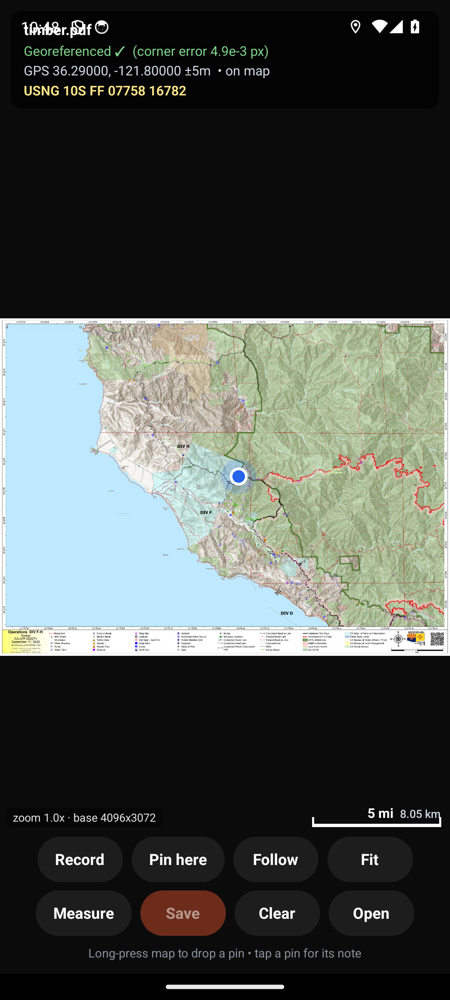
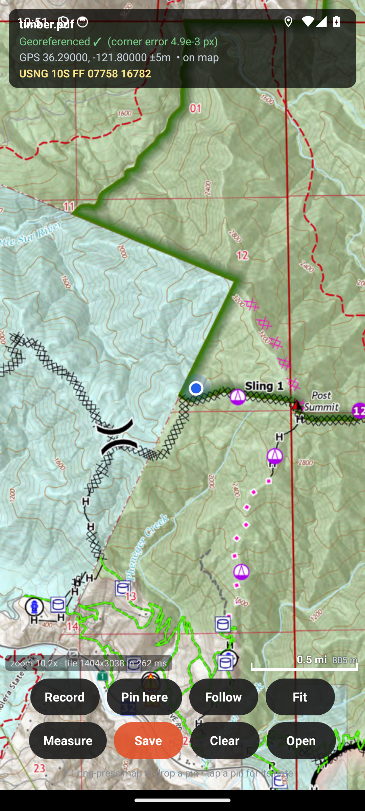

# FreeFireMaps

A free, offline map app for Android, built for wildland fire crews. Open an
incident map (a GeoPDF from CAL FIRE, NIFC, USFS or USGS), and it shows where
you are on it, with no cell signal and no account.

Built with AI assistance (Claude). I designed the features around what I needed
on the fireline.

> **Not an official tool.** Always carry and confirm against your issued maps.

## Why I built this

I worked seven seasons in wildland fire. Avenza now costs money, and Ignis
would often not work offline, which left the crew sharing one map from the guy
who had paid. FreeFireMaps does one thing: open the incident map and show where
you are, with no signal and no account.

## Screenshots

  
  &nbsp;&nbsp;
  

The real CAL FIRE Timber incident map with a simulated GPS position. Left: the
whole map. Right: zoomed in about 10x, still sharp.

## What it does

- **Shows your position on the fire map.** Open the map PDF you were issued and
  a dot shows where you are, using the phone's GPS. No internet needed.
- **Stays sharp when you zoom.** Map text and lines stay crisp at any zoom.
- **Pins with notes.** Long-press to drop a pin (for example "DP 3"), and record
  the path you walked. Saved with each map.
- **Grid readout.** Your position in USNG/UTM, the grid crews use on the radio,
  plus a heading arrow and a scale bar.
- **Follow-me** keeps the map centred on you.
- **Measure** distance and bearing between points.
- **Recent maps** on the home screen, and "Open with…" from Files, Drive, email
  or a download.

## Install

Download the APK from the [latest release](../../releases/latest) and open it on
your phone (allow installs from your browser or file manager when asked). It
runs on 64-bit Android phones, which is nearly all phones made since about 2017.

## How it works, in short

A GeoPDF is a normal PDF map with a small hidden table inside it that says which
points on the page match which spots on the ground. FreeFireMaps reads that
table, works out the conversion between page and ground, and uses it to put your
GPS position in the right place on the page. Everything happens on the phone, so
it works with no signal.

## For developers

Build steps, the automated checks and the code layout are in
[docs/DEVELOPMENT.md](docs/DEVELOPMENT.md).

## License

MIT. See `LICENSE`. The Timber incident map in `test-maps/` is a public CAL FIRE
document used for the automated checks.
